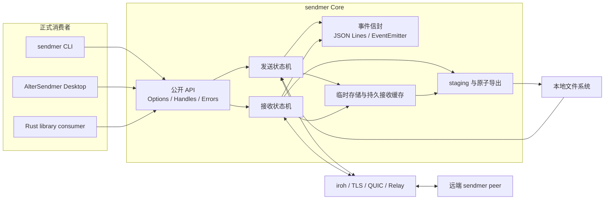

# sendmer 主线设计与开发计划

本文是 sendmer 唯一的主线设计与开发计划。它合并已发布能力、稳定接口约定、当前阶段路线、
验收条件和延期边界。历史迁移指南、版本设计说明和 Release Notes 继续独立保留，但不再作为
当前开发计划的第二来源。

## 1. 术语表与命名约定

| 规范名称 | English / 缩写 | 职责边界 | 不代表什么 |
| --- | --- | --- | --- |
| 核心传输层 | sendmer Core | 提供 Rust crate、CLI、ticket、点对点传输、重试、限速和资源清理 | 不负责桌面 UI、账号或云端文件托管 |
| 桌面客户端 | AlterSendmer Desktop | 通过正式发布的 sendmer API 提供 GPUI 交互、配置、历史和平台集成 | 不复制协议、缓存数据库或限速器 |
| 传输票据 | Ticket | 允许接收方连接并请求内容的 bearer capability | 不是账号、长期授权或云端分享链接 |
| 传输会话 | Transfer Session | 一次 send 或 receive 的应用层生命周期 | 不是单条 QUIC 连接或 provider request |
| 事件信封 | Event Envelope | 承载 schema 版本、会话标识、顺序、阶段和事件载荷 | 不参与控制流，也不替代函数返回值 |
| 结构化错误 | Transfer Error | 提供稳定错误码、失败阶段、可重试属性和安全摘要 | 不是本地化文案或完整内部错误链 |
| 原子导出 | Atomic Export | 完整下载后从 staging 以 no-replace 方式提交最终根 | 不是覆盖、合并或自动重命名已有目标 |
| 上传速率上限 | Upload Rate Limit | 一个 sender 对所有接收方共享的 payload bytes/s 上限 | 不是每个 peer 的独立配额或精确线路 QoS |
| 持久接收缓存 | Persistent Receive Cache | 在多个 receive 进程间复用 iroh 已验证的数据范围 | 不是最终下载目录、云存储或跨设备同步 |
| 缓存排他锁 | Cache Lock | receive 进程对单个缓存条目的跨进程排他占用 | 不是网络会话、ticket 有效期或永久所有权 |

本文、README、代码注释和 AlterSendmer 文档统一使用这些名称。标准协议名 `QUIC`、`TLS`、
`JSON Lines` 和 `SHA-256` 保留标准大小写。

## 1.1 2026-11-26 简化实施基线

本批次冻结新增协议能力，优先降低核心库和桌面客户端的维护成本。核心代码已按职责拆分为
`transport`、`transfer`、`manifest`、`recovery`、`filesystem` 和 `events` 六个边界。
`sender`、`receiver`、`progress` 和接收缓存目录是这些边界在 Rust crate 内的实现目录。

已完成的结构调整包括：

- 事件模型、顺序校验和进度发射拆分为独立文件。
- TM1 manifest 模型、路径编码和校验拆分为独立文件。
- 接收缓存的 manifest、Lease、锁、容量检查和过期清理拆分为独立文件。
- sender 和 receiver 的准备、导入、下载、重试、导出和终态处理拆分为独立文件。
- iroh endpoint 入口移入 `core/transport`。
- staging、路径安全、目标冲突和原子提交移入 `core/filesystem`。
- 新增 `RecoverySnapshot`，只记录会话角色、会话标识、已验证范围、处理字节和终态。
- 新增 `send_handle(path, options)` 和 `receive(ticket, options)` 作为主要库入口。
  事件、取消和资源上限入口保留一个兼容周期。

当前代码和函数大小验收覆盖源码、测试和安装脚本。

- Rust、Shell 和 PowerShell 代码文件均不超过 600 行。
- 单个函数均不超过 120 行，测试函数也必须遵守该限制。
- stable Rust `1.100.0` 下 format、严格 Clippy、workspace tests 和 CLI tests 通过。
- relay 和弱网测试继续使用显式 opt-in。未执行时保持 ignored，不把本地 loopback 结果写成真实 relay 结果。

本次简化前的验收发现 CLI 和弱网测试超过大小限制，且 sender 和 receiver 通过 `include!`
共享作用域。C12.1 已拆分超限测试并增加大小门禁；C12.2 已将目标模块改为真实 Rust 子模块，
使用明确的内部接口约束依赖方向。

`AlterSendmer v0.8.0` 已完成迁移，使用 crates.io 的固定版本 `sendmer = "=0.13.0"`，不再依赖
`sendmer::core::*`。兼容入口继续保留一个发布周期。AlterSendmer 是与 sendmer 同步维护的正式
下游客户端；已停止维护的是独立项目 AlterSendme。桌面端的 UI 状态、历史、偏好和更新逻辑继续
由 AlterSendmer 持有，缓存布局、导出提交和恢复范围由 sendmer Core 持有。

## 1.2 2026-11-26 代码审查后的后续计划

本计划以 `main` 为唯一开发分支。分支收敛提交为 `da6c14c`，远端已删除功能分支。当前代码审查
保留以下核心能力：iroh 传输、文件和目录发送、BLAKE3 校验、原子导出、目标冲突拒绝、基本重试、
基本取消和基本进度事件。新增协议能力暂缓，后续工作只降低耦合、收敛接口和补齐已有能力的验收证据。

审查确认的维护问题如下：

- 事件校验器检查序号和终态，但没有集中校验阶段转换。
- `RecoverySnapshot` 只有数据结构和单元测试，没有接入接收缓存的实际读写流程。
- `core` 仍公开多个内部模块，兼容入口和 `SendResult` 内部字段继续扩大公共 API。
- sender 和 receiver 的文件拆分没有形成真实模块边界。
- 默认 feature 仍启用 clipboard，更新检查实现位于核心模块，增加了默认构建的维护范围。
- 安装器仍接受 macOS `x86_64`，与 ARM64-only 发布矩阵不一致。
- CLI 测试和弱网测试超过文件或函数大小限制。

| 阶段 | 负责范围 | 主要工作 | 通过条件 | 回滚边界 |
| --- | --- | --- | --- | --- |
| C12.1 平台与大小约束 | sendmer | 拒绝 macOS Intel 安装目标；拆分超限测试；增加文件和函数大小检查 | 安装器测试覆盖 ARM64 成功和 Intel 拒绝；所有代码文件不超过 600 行；所有函数不超过 120 行 | 只回退安装器、测试和检查脚本 |
| C12.2 模块边界 | sendmer | 将 `sender`、`receiver` 和测试从 `include!` 改为真实子模块 | 模块只通过明确接口交互，严格 Clippy 和 workspace 测试通过 | 每个模块拆分保持独立提交 |
| C12.3 统一状态机 | sendmer | 定义统一的内部传输状态，集中校验阶段转换和终态 | 非法阶段、重复终态、终态后事件和跨角色事件均有单元测试 | 保留现有事件 schema，先回退内部状态实现 |
| C12.4 恢复流程 | sendmer | 接入 `RecoverySnapshot` 的原子读写、范围校验、TTL 和终态判断 | 中断、重启、发送方重启、过期、旧 schema 和损坏快照测试通过 | 可关闭快照复用，保留已验证缓存数据 |
| C12.5 API 迁移 | sendmer 与 AlterSendmer | 统一 CLI/库公共 API、收紧 core 与 SendResult，迁移桌面客户端 | 核心 API 接口约定、格式、Clippy、测试通过；AlterSendmer v0.8.0 使用 sendmer 0.13.0 且不依赖 core | 兼容入口保留一个发布周期 |
| C12.6 可选功能 | sendmer | 将 clipboard、manifest、JSON Lines、持久恢复、诊断和 updater 移入 feature 或 CLI 层 | 默认构建、`--no-default-features` 和 `--all-features` 均通过，v0.13.0 已发布 | 保留旧 feature 名称，下一版本再移除默认启用 |

**C12.1 本地实施记录（2026-11-26）**：基于 `1312081`，安装器在下载前拒绝 macOS Intel
目标，测试覆盖 ARM64 两种架构名称、Intel 拒绝及原有签名失败。CLI 和弱网测试按职责拆分，
保持现有集成测试入口、断言和 opt-in 条件；真实子模块仍属于 C12.2。CI 和 Release Quality Gate
使用语法解析器检查 Rust、Shell、PowerShell 和 Python 文件及命名函数的物理行数。
本地扫描 87 个代码文件、775 个函数，最长分别为 595 和 111 行。

Linux x86_64 / Rust 1.100.0：format、严格 Clippy、无默认 feature 检查、Rustdoc、安装器模拟、
actionlint、发布版本/说明/资产契约演练通过。首次 workspace 测试的限速用例出现接收 endpoint
关闭超时；单独复测通过，完整复跑 250 项通过、2 项按原条件 ignored。未修改核心关闭逻辑或测试
阈值。Linux PowerShell 7.7 模拟失败清理和演练脚本语法通过；原生 macOS/Windows、真实 relay
及 macOS 弱网注入未执行。本地验收证据不替代这些平台的 CI 或真实签名资产安装验证。
C12.1 已通过 PR [#9](https://github.com/bruceblink/sendmer/pull/9) 合入 main（`f60c5e3`）；
[PR CI](https://github.com/bruceblink/sendmer/actions/runs/45747157746) 和
[main CI](https://github.com/bruceblink/sendmer/actions/runs/45747197657) 均成功。未发布新版本。

**C12.2 本地实施记录（2026-11-26）**：基于 main `f60c5e3`，sender 和 receiver 分别迁移为 5 个和
10 个私有实现子模块，保留原有公开重导出；核心测试、CLI 和弱网 fixture 使用真实子模块。
内部依赖显式导入，生产模块的同级导入图无环。迁移范围内的 291 个函数和 127 个测试（含平台条件及
ignored 属性）保留，10 个公开函数签名一致；除测试调用路径调整外函数 token 一致（排除可见性、
注释和格式化尾逗号）。现有 `--test cli`、`--test weak_network_smoke` 及函数名子串过滤保留，
完整测试名称随模块路径改变。filesystem 的两个 `include!` 不在本阶段迁移范围。

Linux x86_64 / Rust 1.100.0：sender 41 项、receiver 52 项单独测试通过；
完整 workspace 250 项通过、2 项按原 opt-in 条件 ignored，CLI 30/30 通过。
严格 Clippy、format、无默认 feature、Rustdoc、doc tests（无示例）、actionlint、安装器模拟及
Release version/notes/assets 契约检查均通过。大小门禁扫描 95 个文件、775 个函数，
最长分别为 595 行和 111 行。macOS 专用弱网 fixture 在 Linux 临时启用模块后编译和 Clippy 通过，
平台条件已恢复；没有执行真实 macOS/Windows、relay 或故障注入，原生平台验证以 CI 为准。
未改变协议、事件 schema、公开 API、依赖或版本号，不实施 C12.3 至 C12.6。

**C12.3 实施记录（2026-11-26）**：基于 main `501c6a0`。C12.2 已通过 PR #10 合并，但
[PR CI](https://github.com/bruceblink/sendmer/actions/runs/45753289801) 和
[main CI](https://github.com/bruceblink/sendmer/actions/runs/45753306798) 的 Windows MSVC/GNU
六个矩阵任务失败，日志定位到两个 Unix 专用测试导入未设置 cfg(unix)。
C12.3 首先独立修复该问题，不改变测试或降低警告标准。

事件发射器和事件流校验器共享内部 EventStreamState，集中维护会话 ID、角色、序号、活动阶段和
互斥终态。发射器在同一会话锁内计算取消/内部失败阶段、校验、分配序号并发射；拒绝无效输入不消耗
序号。消费者保留首次错误并永久拒绝该流。保留 metadata-after-progress、重试失败报告早期阶段、
无进度完成、sender 多接收方共享会话等已有语义；不新增 wire 事件，不改变 schema 1。
公开校验错误枚举新增 InvalidPhase（穷举匹配需要适配），其余公开入口和错误分支保留；
README、迁移指南、fixture 和示例同步更新，AlterSendmer 后续迁移时处理此分支。
本阶段不更改恢复快照、缓存、网络关闭逻辑、依赖或版本。

Linux x86_64 / Rust 1.100.0：完整 workspace 首轮 260 项通过、1 项接收 endpoint 关闭超时、
2 项按原条件 ignored。失败的 send_recv_dir 单独复测通过（2.07 秒）；完整复跑 261 项通过、
2 项 ignored，CLI 30/30。新增 11 项测试覆盖阶段矩阵、终态尾部事件、重试兼容、序号耗尽、
非法阶段 JSONL 和并发竞争。严格 Clippy、format、无默认 feature、Rustdoc、doc tests（0 项）、
大小检查（99 个文件、800 个函数；最大 595/111 行）、actionlint、安装器模拟及发布版本/说明/资产
契约均通过。原生 Windows/macOS 和真实 relay/弱网故障注入不计入本地通过结果。首次关闭超时
根因未确定，未修改阈值或传输逻辑。

**C12.4 实施记录（2026-11-26）**：基于 main `2d00bd2`（C12.3 PR #12 和独立
Windows 修复 PR #11 已合并）。C12.3 PR CI 和合并后 CI 均通过。持久接收缓存条目新增
辅助 RecoverySnapshot 日志 recovery.json，在独占条目锁内校验、原子替换和记录终态。
范围坐标按已验证 hash sequence 及子 blob 尺寸展开；实际缺失范围仍由 iroh store 决定。
旧快照在 TTL、键、角色、schema、区间及终态均有效时与实时 store 校验；不根据快照
跳过任何数据。Failed/Cancelled 可作为恢复摘要，Completed/Expired 不复用。每次接收
使用新事件会话 ID；未知 schema 保留至正常条目清理，损坏快照可重建，关闭快照功能
不关闭既有持久接收缓存。快照同步 I/O 与额外 store 查询的性能开销尚未独立测量。

Linux x86_64 / Rust 1.100.0：新增 8 项恢复单元测试和 1 项 CLI 集成测试，同时扩展既有
失败、取消、接收进程强杀、发送方重启用例。完整 workspace 270 项通过、2 项按原 opt-in
条件 ignored（CLI 31/31），没有修改超时阈值。严格 Clippy、format、无默认 feature、
Rustdoc、doc tests（0 项）、大小检查及其自测、actionlint、安装器模拟和 Release
version/notes/assets 契约均通过。大小门禁扫描 103 个文件、834 个函数，最大 595/115 行。
真实 relay、弱网故障注入、跨平台断电持久性及性能基准未验证；远端平台验证以 CI 为准。
保留协议、事件 schema、公开签名、依赖和版本；不实施 C12.5/C12.6，不发布新版本。

**C12.5 实施记录（2026-11-26）**：基于 main `74420a4`。C12.4 合并后 Linux ARM64
stable 的进程强杀验收暴露快照与 Store 元数据提交之间的时序差异。接收端在记录实时快照前
等待有界 iroh sync_db 屏障，测试等待实际有效检查点后再中断；保留实际 Store 重开和缺失区间
断言，不以 JSON 代替已验证数据，不声称全量数据已 fsync 或断电持久。独立修复提交可回滚。
core 改为私有模块，crate 根部显式导出领域类型和统一收发、生命周期、事件、配额及缓存 API。
CLI 作为外部消费者使用同一公共契约，进度展示、更新检查和哈希格式化位于二进制私有模块，
不设 cli_support 或内部访问通道。已有参数类型与弃用根级入口保留一个发布周期。
SendResult 的 ticket/hash/size/entry_type 和生命周期方法保留，资源句柄收紧。
新增 3 个 doc tests（1 个正向、2 个编译失败）。此次可见性变更属于 Rust 源码破坏性变更；
协议、ticket 和事件 schema 不变，正式发布需要新的次版本。
Linux x86_64 / Rust 1.100.0：最终全量 270 项通过、2 项 ignored（CLI 31/31），
fmt、严格 Clippy、无默认 feature 检查、Rustdoc、3 项 doc tests、大小门禁通过。
105 个代码文件、836 个函数，最大 595/115 行。未验证真实 relay 或断电持久性。
AlterSendmer 与 sendmer 同步维护。根据最新开发顺序，先完成核心 C12.5/C12.6，
发布新的正式 crate，再迁移 AlterSendmer 至该已发布版本；旧项目 AlterSendme 不纳入验收。

**C12.6 实施记录（2026-11-26，v0.13.0）**：C12.5 已通过 PR #14 合入 main
（`515c580`），PR CI 20/20 成功。核心 `v0.13.0` 已发布后，AlterSendmer 完成 `v0.8.0`
迁移。CLI 与 AlterSendmer 通过同一 crate-root API。
新增 cli、manifest、persistent-recovery feature，保留 clipboard 名称并依赖 cli。
默认源码构建启用基础 CLI；无默认 feature 的核心构建不直接依赖 clap、console、indicatif、
tracing-subscriber、crossterm、filetime、fs4。CLI 展示、JSONL、诊断和 updater 在二进制层；
TM1 导入导出、持久缓存和快照逻辑按 feature 编译，公开模型及安全验证保留。
禁用能力明确返回错误：禁用缓存不创建或清理存储；不支持的 TM1 不作为 legacy 数据导出。
正式五平台原生和 cross 构建显式启用全部 feature，兼容既有安装用户。
v0.13.0 是包含 Rust 源码、API 和默认 feature 变更的新次版本，不覆盖已发布 v0.12.0。
Linux x86_64 / Rust 1.100.0：三种构建严格 Clippy 通过；最小库 184 项、默认 CLI 237 项、
全功能 270 项测试通过（默认及全功能各 2 项 opt-in ignored）；默认 CLI 19 项、全功能 CLI
31 项通过。实际 v0.12.0 全功能 sender 到 v0.13.0 默认 receiver 的 TM1 拒绝测试通过，
无导出文件。大小门禁 108 个文件、843 个函数，最大 573/115 行。未验证真实 relay、
故障注入或断电持久性。正式 tag 仅在候选 PR/main CI 与发布前门禁验收完成后创建，
签名、SBOM、provenance 和不可变 release 信任策略不变。GitHub Release、crates.io 和五目标资产
已完成回读，macOS 资产只保留 ARM64。

每个阶段都必须先完成对应验收，再提交和推送。涉及公开 API 时同步更新 rustdoc、示例、fixture、
README、README_ZH 和 AlterSendmer 迁移记录。涉及平台安装器或 workflow 时增加 actionlint、安装器
测试和 release rehearsal。外部 relay 不可达时标记为“未执行”，不把本地 loopback 结果写成真实
relay 结果。

建议的最小验证集如下：

```bash
cargo fmt --all -- --check
cargo clippy --locked --workspace --all-targets --all-features -- -D warnings
cargo check --locked --workspace --no-default-features --bins --tests --examples
cargo test --locked --workspace --all-features --bins --tests --examples
RUSTDOCFLAGS='-D warnings' cargo doc --locked --workspace --all-features --no-deps
bash ./tests/release-version.sh
python3 ./tests/release-notes.py
bash ./tests/release-assets.sh
```

## 1.3 2026-11-28 v0.13.0 之后的研发方向

`sendmer v0.13.0` 和 `AlterSendmer v0.8.0` 已完成核心迁移。后续工作进入稳定性证据、性能边界
和可选适配器评估阶段。新的方向必须复用现有传输、manifest、缓存和原子导出能力，不在核心协议中
复制桌面状态或引入账号、云端存储和后台同步。

| 阶段 | 方向 | 目标 | 验收条件 | 范围边界 |
| --- | --- | --- | --- | --- |
| R13.1 | 真实网络与恢复验收 | 验证 relay、弱网、发送方重启、接收进程重启和缓存过期 | 记录运行环境、故障参数、恢复时间、缺失范围、最终 BLAKE3 和缓存清理结果 | 不修改协议和默认重试参数；服务不可达时记录未执行 |
| P13.1 | 恢复性能与资源边界 | 测量快照检查点、store 查询、缓存占用和大目录导入成本 | 形成 1 MiB、1 GiB、十万文件三个规模档位的基线，报告 CPU、内存、磁盘和耗时 | 不把单机结果写成跨平台结论；不提前增加限额参数 |
| A13.1 | 局域网适配器评估 | 评估发现、设备身份核验和接收确认是否适合作为独立适配器 | 先完成威胁模型、广播字段、用户确认流程和发现失败回退设计 | sendmer Core 继续只处理 ticket 和传输；桌面端负责界面和确认 |
| T13.1 | 文本与批量输入评估 | 复用 TM1 manifest 和现有校验流程支持短文本、链接和批量选择 | 明确字节限制、UTF-8 规则、历史展示、目标冲突和恢复行为 | 不创建第二套传输协议；先完成需求与数据约定 |
| I13.1 | 互通与移动端评估 | 评估 LocalSend 互通和移动端接入成本 | 形成平台能力矩阵、身份确认差异、后台限制和维护成本报告 | 未完成独立安全设计前不进入核心实现 |

优先推进 `R13.1` 和 `P13.1`。它们可以直接验证 v0.13.0 的恢复和资源边界，改动范围集中，回退
只涉及测试、基准和报告。`A13.1`、`T13.1` 和 `I13.1` 先完成设计评估，再决定是否建立新的
代码模块或公开 API。

每个方向都需要建立独立提交、验证命令、未执行项和回滚边界。涉及 AlterSendmer 的工作必须先
确认 sendmer 已有公开 API 可以满足需求。核心 API 变更必须先更新本文件、示例、迁移说明和下游
适配清单，再开始实现。

## 2. 产品边界与当前基线

当前核心发布基线为 `sendmer v0.13.0`。tag `v0.13.0` 指向 `198d650`，Release workflow
`45837190246` 已完成构建和发布，crates.io 可解析 `sendmer 0.13.0`。`AlterSendmer v0.8.0`
使用固定版本 `sendmer = "=0.13.0"`。本项目提供一次性的点对点文件传输。接收方持有有效传输票据即可请求内容，
因此用户应通过可信渠道分享票据。

核心传输层负责：

- 基于 iroh、TLS 和 QUIC 的直连、NAT 穿透与 relay 回退。
- 文件和目录的导入、请求、重试、超时、原子导出、路径安全及清理。
- `SendHandle`、receive 取消、结构化错误、版本化事件和 JSON Lines 输出。
- sender 共享上传限速和可选持久接收缓存。

历史发布事实：`sendmer v0.10.0` 的 tag 指向 `fe1f475`；`AlterSendmer v0.6.0` 的 Release
workflow `32866559790` 已完成三个平台打包、签名、SBOM、provenance、更新清单和 checksum，
共上传 23 个资产。`sendmer v0.11.0` 已于 2026-10-09 发布，tag 指向
`afb449069155d7d8b661f5f3a84ff1dfc573b54a`；GitHub Release 工作流 `37939914533` 全部成功，
发布页上传 36 个归档、checksum、SBOM、Sigstore 签名和 provenance 资产，crates.io 已可解析
`sendmer 0.11.0`。`AlterSendmer v0.7.0` 已完成该核心版本的桌面适配和三平台发布。
`v0.7.1` 修复 macOS 图标，核心依赖继续使用 `sendmer 0.11.0`。当前 release 和 CI 的 macOS
目标只保留 ARM64，安装器、资产检查和相关文档必须保持相同约束。

核心传输层不负责：

- GPUI 状态、语言、主题、历史、系统文件选择器和应用更新。
- 账号、云端文件托管、多租户控制面、后台同步服务或自建 relay 运维。
- 在没有明确 backpressure 设计前伪造接收端下载限速。

## 3. 总体架构与依赖方向



依赖方向只能从消费者指向公开 API。AlterSendmer 不得依赖 iroh 内部类型、缓存布局、Router
或临时目录；sendmer 也不得反向依赖 GPUI。跨项目发布依赖必须使用 crates.io 上的 sendmer
版本号，不使用本地 path、Git revision 或提交哈希作为发布依赖。

## 4. 已冻结的核心接口约定

### 4.1 生命周期、取消与资源所有权

- `SendHandle` 是发送会话的 opaque 所有者，负责 `status`、`cancel` 和 `close`；兼容用旧 API
  不应成为新消费者的首选。
- `SendHandle::cancel` 是主动撤销：它先唤醒并停止 provider，再关闭 router，因此旧 Ticket
  只在 router 存活期间有效；Ticket 是 bearer capability，不代表账号、持久 ACL 或撤销列表。
- sender 关闭时依次停止 router/progress/store，释放文件句柄后再删除临时目录。
- receive 取消、失败和成功都必须有单一终态；清理失败保留原始业务错误并附加清理上下文。
- 单个接收方完成或中止不会终止整个 sender 会话，CLI 默认持续共享到用户主动停止。

### 4.2 接收、路径和数据完整性

- 下载阶段在同一次 receive 中复用已验证范围，并按策略重连；连接、元数据和下载空闲超时均
  可配置，未配置时保持底层默认行为。
- 导出先写入输出目录内的 staging，确认全部 `Done` 后再提交最终根；流提前结束视为失败。
- 冲突策略固定为 `fail`：已有文件、目录或符号链接不覆盖、不合并、不自动重命名。
- 导出提交使用平台 no-replace 原语；路径 traversal、绝对路径、symlink 逃逸和多顶层根均拒绝。
- 当前 collection 只表示常规文件。空目录、空子目录和符号链接在发送端明确拒绝，不静默丢失。

### 4.3 上传速率上限

- `SendOptions::max_upload_rate_bytes_per_sec` 和 CLI `--max-upload-rate` 接受非零 bytes/s；未设置
  表示不启用 throttle 路径。
- provider 的 throttle 事件按实际 chunk `size` 在一个共享时间线中调度，所有接收方共享同一
  sender 总上限。
- 限速只覆盖文件 payload，不承诺包含 Bao、QUIC 或 relay 开销；拥塞、磁盘和对端速度可以让
  实际吞吐低于配置值。
- 本版本不提供每个 peer 独立配额、运行中动态调速或接收端 sleep 限速。

### 4.4 事件信封与结构化错误

事件 schema `1` 的稳定字段如下：

| 字段 | 规则 |
| --- | --- |
| `schema_version` | 固定为 `1`，它不是 crate 版本 |
| `session_id` | 独立随机 128 位标识，不从 ticket、hash 或网络身份派生 |
| `sequence` | 每个会话从 `1` 严格递增，消费者以它判断顺序 |
| `timestamp_ms` | Unix epoch 毫秒，仅用于展示和跨进程关联 |
| `role` | `sender` 或 `receiver`，同一会话固定为首条事件的角色 |
| `phase` | `preparing`、`connecting`、`metadata`、`transferring`、`exporting`、`finalizing` |
| `event` | `started`、`progress`、`file_names` 或唯一终态 |

`completed`、`failed`、`cancelled` 三种终态互斥且只发出一次。公开错误码包括
`invalid_input`、`connection_failed`、`timeout`、`remote_rejected`、`transfer_interrupted`、
`target_conflict`、`filesystem` 和 `internal`。事件不得包含完整 ticket、绝对路径、私钥、
relay token 或底层连接标识。`file_names` 只能携带使用 `/` 分隔的相对逻辑路径；空组件、`.`、
`..`、绝对路径、Windows 驱动器限定路径（drive-qualified path）和反斜杠名称会在事件发射、
反序列化或 JSON 序列化前拒绝，拒绝信息不回显原始名称。核心 tracing 的失败与清理诊断只记录
稳定的阶段、错误类别、重试属性和尝试次数，不记录源路径、输出路径、ticket 或底层连接错误文本；
发送模式、规模和进度等非敏感运行元数据可以保留。

### 4.5 持久接收缓存

- 未显式配置缓存时使用进程级临时 store，结束后清理；显式启用时按内容 hash 和 blob 格式
  选择缓存条目。
- `manifest.json` 只保存布局/schema 版本、缓存键、创建或刷新时间和 TTL；不保存完整 ticket、
  发送方地址、最终绝对路径或 GUI 历史。
- 同一条目使用非阻塞排他锁；缓存根维护锁和条目锁遵循固定顺序，进程崩溃后由操作系统
  释放句柄。
- 失败、超时或取消后保留已验证数据；后续进程通过 `local().missing()` 请求缺失范围；成功
  原子导出后删除对应条目。
- prune 只删除已过期、schema 已知且未被占用的条目；活动、损坏、未知或未来 schema 数据保留。
- `recovery.json` 是 schema 1 的辅助记录，绑定缓存键、更新时间、传输总字节数和
  RecoverySnapshot。区间坐标按根 hash sequence、collection metadata、各子 blob 的顺序展开，
  使用实际缺失 BAO chunk 的补集，末块裁剪至已验证尺寸；processed_bytes 仅是进度记录。
  旧快照仅在 TTL、角色、键、schema、范围和终态有效且范围仍被当前 store 覆盖时作为可信摘要。
  恢复请求始终由 iroh store 生成，不根据快照跳过数据。新接收生成新事件会话 ID。
- 快照最多 1 MiB、8192 个区间；周期检查点约每秒一次，并在重试和终态时刷新。
  条目锁内同目录临时文件同步后原子替换，Unix 额外同步目录；不保证所有平台断电持久性。
  不支持的快照 schema 保留至条目正常清理，损坏的受支持快照可重建，快照错误不删除 blob。
  环境变量 `SENDMER_DISABLE_RECOVERY_SNAPSHOT=1` 禁用快照读写，不禁用持久缓存。
- 跨进程恢复仍要求有效 ticket；存在缺失数据时需要可重新连接的发送端。已完整缓存可以重新导出，
  但不提供任意内容的离线下载或永久会话。

## 5. 已完成版本与跨项目对齐

| 核心版本 | 已完成能力 | 对应桌面版本 |
| --- | --- | --- |
| `v0.6.0` | 原子导出、no-replace、数据重试/超时、路径与清理基线 | 早期 GPUI 主线 |
| `v0.7.0` | `SendHandle`、receive 取消、sender 共享上传限速、基础 JSON 事件 | `AlterSendmer v0.3.0` |
| `v0.8.0` | 版本化事件信封、严格序号、单终态与结构化错误 | `AlterSendmer v0.4.0` |
| `v0.9.0` | 持久接收缓存、TTL/prune、跨进程中断与发送端重启恢复 | `AlterSendmer v0.5.0` |
| `v0.10.0` | 会话生命周期与资源上限、TM1 manifest、供应链证明和六平台发布覆盖 | `AlterSendmer v0.6.0` |
| `v0.11.0` | 事件流角色一致性校验、CLI 短帮助分层和依赖安全补丁 | `AlterSendmer v0.7.0`、`v0.7.1` |
| `v0.11.1` | 缓存动态配额检查、句柄导入、准备阶段取消和导出路径安全修复 | 待桌面适配 |
| `v0.11.2` | 修复 macOS ARM64 GitHub runner 标签并恢复完整发布矩阵 | 待桌面适配 |
| `v0.13.0` | 统一事件状态机、持久恢复快照、真实模块边界、可选 feature 和 crate-root API | `AlterSendmer v0.8.0` |

`AlterSendmer v0.6.0` 使用 `sendmer = "0.10.0"`，只映射公开配置、事件和结构化错误：上传
上限以 MiB/s 输入后转换为 bytes/s；持久缓存默认启用并提供 `1 / 7 / 30` 天新条目 TTL 和安全
prune；会话过期、接收方上限和 TM1 通过公开选项与结果展示。缓存格式、锁、恢复状态机、manifest
解析和实际限速器仍只由核心传输层维护。桌面端发布遵循第 8 节的跨项目顺序，不使用本地 path
或 Git revision 绕过正式版本。

## 6. v0.10.0 已完成范围与验收

`v0.10.0` 已完成设计评审、实现、独立测试和正式发布。以下记录冻结范围与验收边界；不把
协议、GUI 或服务端架构追加到已发布版本。

### M10.1 会话控制与规模边界

- `SendOptions::max_receivers` 与 CLI `--max-receivers` 已实现同时活动 provider 连接数上限；默认不限制，断开连接会释放名额，超限连接由 provider 层拒绝。
- `SendOptions::max_files` 与 CLI `--max-files` 已实现普通文件数量上限；默认不限制，目录超限会在网络和临时存储初始化前以 `InvalidInput` 拒绝。
- `SendOptions::max_total_size_bytes` 与 CLI `--max-total-size` 已实现普通文件总 payload 大小上限；默认不限制，文件长度总量超限会在网络和临时存储初始化前以 `InvalidInput` 拒绝。
- `SendHandle::cancel` 的主动撤销和旧 Ticket 失效已有本地回归；`SendOptions::session_lifetime` 与
  CLI `--session-lifetime-seconds` 已实现 ready 后固定生命周期、`Expired` 状态和不可重试超时事件，
  不改变现有 Ticket 的 bearer capability 兼容性；设计与边界见
  [`V0_10_SESSION_LIFETIME_DESIGN.md`](V0_10_SESSION_LIFETIME_DESIGN.md)。
- `SendOptions::max_import_memory_bytes` 与 CLI `--max-import-memory` 已实现导入工作集预算；它限制并行
  导入任务估算的普通文件字节，不伪称为进程 RSS 或操作系统硬内存上限。大文件和大目录基准已记录在
  [`V0_10_SCALE_BENCHMARK.md`](V0_10_SCALE_BENCHMARK.md)。
- 已补两个真实并行接收方共享总上传上限的本地 E2E；sender 关闭会立即唤醒并终止尚未放行
  的限速等待；relay-only 与弱网重启 smoke 均已提供显式 opt-in 测试。

验收：控制操作有稳定 API/错误码；现有 ticket 默认行为兼容；资源上限不会破坏取消、清理或
多接收方状态；基准结果记录环境并避免把网络抖动写成严格单点时序断言。

### M10.2 文件系统语义与 manifest 演进

- TM1 版本化传输清单已冻结术语、wire schema、路径编码、元数据边界和旧 Collection V0
  兼容规则，详见 [`V0_10_MANIFEST_DESIGN.md`](V0_10_MANIFEST_DESIGN.md)。
- `--manifest` 与 `SendOptions::manifest_mode` 已提供显式 opt-in：使用保留 Collection 条目
  携带 TM1 JSON，接收端自动识别并在 staging 中还原空目录、普通文件、POSIX mode/Windows
  read-only 属性和修改时间；旧 file-only collection 仍保持默认。
- TM1 对路径、payload 映射、重复项、未来 schema 和目录/文件冲突执行 fail-closed 校验；Unix
  非 UTF-8 组件使用 `unix_bytes_hex`，无法安全 materialize 的目标平台拒绝而不替换名称。
- 符号链接默认继续拒绝；只有威胁模型、目标平台语义和安全导出策略明确后才考虑 opt-in。
- 保持旧 file-only collection 可读取，并提供明确的 schema 迁移和不支持错误。

验收：Windows UTF-8 round-trip 和空目录 fixture 已通过；manifest JSON、恶意路径、未来 schema、
文件/目录冲突、Unix 非 UTF-8 文件名、Unix mode 和跨平台时间戳均有测试。CI 的原生矩阵覆盖
Linux、macOS、Windows（MSVC/GNU），并将真实权限/时间戳与原始名称检查作为发布前检查；当前
开发机已完成 Windows 与 WSL Linux 全量测试，macOS 结果仍以对应 runner 的 CI 记录为准。
失败或冲突时仍无半导出和越界写入。

### M10.3 供应链与平台覆盖

- Release 资产的签名、SBOM 和构建 provenance 约定已冻结，详见
  [`V0_10_RELEASE_PROVENANCE.md`](V0_10_RELEASE_PROVENANCE.md)，并已接入 release workflow：每个
  target 在上传前生成 SPDX SBOM、archive/SBOM Sigstore bundle 和 GitHub provenance bundle。
- Unix 与 PowerShell 安装器在解压前下载并校验 checksum、签名 bundle 和 provenance 文件；缺失
  `cosign` 或任一信任材料为空时 fail closed。
- CI native acceptance 已覆盖 Linux x86_64/ARM64、macOS ARM64 和 Windows MSVC/GNU；
  release workflow 仍保留 Linux/macOS ARM64 的交叉构建与资产发布矩阵。
- 保持 release workflow 可重入：同一 tag 重跑时更新 Release 正文，不制造重复资产或版本。

验收：签名与校验失败均 fail closed；SBOM/provenance 可由发布 tag 追溯；所有资产名、checksum、
安装器选择规则和 CI native platform matrix 均有自动化测试。

## 7. 历史质量改进记录与补充验收

本节保留 2026-08-26 起的历史批次、测试证据和发布记录。当前后续开发以第 1.2 节的 C12 批次为准，
本节中的旧批次状态只用于回溯，不覆盖新的优先级和验收条件。

### 7.1 阶段目标与版本策略

2026-10-08 调整开发重点：sendmer 后续功能优先改善核心库的传输性能、资源使用、重试、取消
和清理稳定性。常规发送与接收继续使用 `sendmer send <PATH>` 和 `sendmer receive <TICKET>`。
核心改进优先使用合理默认值和库 API，不因内部实现改进增加 CLI 参数。

本次 CLI 简化范围：`-h` 只展示常用选项和最短示例；现有 `--help` 展示完整高级选项。
已有参数的解析和默认传输行为保持兼容。验收使用真实 CLI 子进程检查短帮助、完整帮助和
最短命令解析；不增加参数或配置文件。格式、Clippy、build 和参数回归通过后，帮助简化作为
独立提交交付；回退只涉及帮助分层、示例和对应文档。

2026-10-08 本批收尾记录：格式、Clippy、build/check、文档和 MSRV `1.91.0` 检查通过。
完整测试在 `TOKIO_WORKER_THREADS=2`、`CARGO_INCREMENTAL=0` 和 `--test-threads=1` 条件下
通过：库 159 项、二进制 5 项、CLI 26 项、帮助 3 项。无默认 feature 的帮助测试另有 3 项通过。
默认并行运行仍有取消接收用例在 30 秒内无 payload 进度的问题；该结果保持未通过，不能以
串行结果替代。relay 和弱网测试未启用，GUI 验收不适用。
按本次收尾要求先提交并推送当前代码；依赖升级、RustSec 审计和新版本发布留待后续，
本批不创建新版本标签，也不宣称 C11.1 或整个下一阶段已完成。

2026-10-09 依赖锁文件更新：在保持 `iroh = "1"`、`iroh-blobs = "0.103"`、MSRV `1.91`
和公开 API 不变的前提下，锁定 `crossbeam-epoch 0.9.20`、`h2 0.4.16`、`rustls 0.23.45`、
`rustls-webpki 0.103.14`、`lru 0.18.2`、`plist 1.10.0` 和 `quick-xml 0.41.0`。这些更新
覆盖本批已识别的修复版本下界，并保持 macOS `plist` 路径的兼容约束。依赖变更只修改
`Cargo.lock`，不增加 CLI 参数。完整 RustSec 数据库审计按本阶段用户指令暂缓，发布前必须
重新运行审计并记录剩余的未维护依赖、yanked 版本和最终结果。

2026-10-09 版本决策：发布 `v0.11.0`。新增 `TransferEventStreamError::RoleChanged` 是公开枚举
变化，可能要求下游穷举匹配增加分支；README、迁移指南、事件 fixture 和版本矩阵已同步。
发布 tag 只允许指向通过 release workflow 所有检查的提交。

发布结果：`v0.11.0` 的 quality gate、六平台构建、Sigstore 签名、SBOM、provenance、Release
创建和 crates.io 发布均成功。Release 地址为
[`github.com/bruceblink/sendmer/releases/tag/v0.11.0`](https://github.com/bruceblink/sendmer/releases/tag/v0.11.0)。
本地 RustSec 审计仍按用户指令暂缓；yanked 依赖警告已由 `cargo package` 记录，后续依赖维护批次
需要单独处理。

本阶段以已发布的 `sendmer v0.10.0` 和 `AlterSendmer v0.6.0` 为稳定基线，先提升桌面端的
可用性、可访问性和诊断质量，再用可复现证据决定是否需要新的核心版本。默认策略如下：

1. 只改 AlterSendmer 的界面、偏好、历史或打包行为时，发布桌面补丁或次版本，不升级 sendmer。
2. 只修复 sendmer 中可复现的回归、清理、跨平台或发布工程问题时，按 SemVer 评估
   `v0.10.1`；修复必须保持已有公开接口和默认行为。
3. 本阶段已发布 `sendmer v0.11.0`，因为事件流错误枚举新增公开变体，穷举匹配的消费者需要迁移；
   tag、Release、资产和 crates.io 版本已经完成回读。

本阶段不以增加协议功能数量为完成标准，而以用户可完成一次可靠传输、开发者可消费稳定事件、
维护者可复现发布结果为完成标准。每个批次均须有负责人、前置条件、出口证据和失败处理。

### 7.2 开发批次

| 批次 | 状态 | 负责仓库 | 主要工作 | 前置条件 | 出口证据 |
| --- | --- | --- | --- | --- | --- |
| N11.0 基线冻结 | 已完成本次整理 | 两个仓库 | 记录版本、tag、依赖来源、测试矩阵、未完成项和敏感信息清单；清除旧计划引用 | `v0.10.0`、`AlterSendmer v0.6.0` 可回读 | 本文件基线记录、干净工作区、链接检查和公开 API 清单 |
| A11.1 桌面质量 | 进行中 | AlterSendmer | 长 ticket、键盘焦点、AccessKit 标签、最小窗口、高 DPI、21 种语言、历史/偏好迁移、诊断导出、退出清理和更新失败恢复 | N11.0；不需要新的 sendmer API | Windows 真实截图与操作日志、Linux/macOS 原生 CI、locale 完整性和隐私检查 |
| C11.1 核心可靠性 | 进行中 | sendmer | 补齐 sender 中断/过期、receiver 取消/重试、持久缓存恢复、接收方上限释放、staging 清理和冲突保护的跨进程回归；只修复可复现问题 | N11.0；发现缺陷时建立最小复现 | locked workspace 测试、失败日志、无半导出、无临时目录泄漏、目标内容不变 |
| C11.2 可观测性评审 | 进行中 | sendmer 与 AlterSendmer | 固定 JSON Lines 的 stdout/stderr 边界、schema `1` 序号/终态、结构化错误和敏感字段脱敏；评估是否需要新的缓存诊断或运行时控制 API | C11.1；新 API 必须先在本文件冻结边界 | rustdoc、可编译示例、事件 fixture、未知字段/乱序事件测试和迁移说明 |
| R11.1 发布可复现性 | `v0.11.0` 已完成 | sendmer | 维护六平台 CI、安装器失败清理、release notes、checksum、签名、SBOM、provenance 和重跑幂等性 | A11.1/C11.1/C11.2 相关批次通过 | actionlint、版本/资产/安装器测试、release rehearsal、workflow `37939914533` 和 36 个资产 |
| D11.1 版本决策 | `v0.11.0` 已完成 | sendmer | 发布 `0.11.0`，同步 README、版本矩阵、迁移入口和 Release notes | R11.1 发布检查通过 | tag、crate、Release、依赖解析可回读 |

每个批次只解决一个可验收主题。测试、原生验收或发布证据缺失时，批次保持“进行中”，不得
通过文档措辞标记为完成；relay 或弱网服务不可达时只记录“未执行”和前置条件。

### 7.3 批次实施细则

#### N11.0：基线冻结

- 核对 `Cargo.toml`、`Cargo.lock`、crates.io source、远端 tag、GitHub Release 和两个仓库的
  `main` 状态；记录核对日期和提交，而不是沿用旧执行记录中的数字。
- 建立公开 API 使用清单：`SendOptions`、`ReceiveOptions`、`SendHandle`、
  `ReceiveCacheOptions`、`TransferEventEnvelope`、`TransferEventStreamValidator`、
  `TransferEventStreamError`、`TransferError` 和 `prune_receive_cache`。
- 建立日志脱敏清单：完整 ticket、绝对路径、节点密钥、relay token、底层连接标识和缓存内部
  路径不得进入事件、历史、诊断导出或 Release 产物。
- 将过时的下一阶段文件从仓库移除；版本设计、迁移指南和历史 Release Notes 仍按其用途保留，
  不把它们当作当前开发计划。

出口条件：两个仓库版本和远端状态有可回读记录；`rg` 找不到已删除计划的引用；本文件成为唯一
当前计划来源。

#### A11.1：桌面质量

- 长 ticket 输入、粘贴、选择、错误摘要和重试按钮在默认窗口、最小窗口和高 DPI 下不遮挡，
  旧 generation 的异步结果不能覆盖新任务。
- 为键盘焦点、AccessKit 标签、语言浮层和帮助展开补齐可重复验收；English 和简体中文必须
  覆盖新增文案，其余 locale 保持完整性检查通过。
- 偏好和旧历史 JSON 使用兼容默认值；诊断导出只包含角色、阶段、错误码、序号、耗时和安全
  摘要，不复制 ticket、绝对路径或内部缓存字段。
- 应用退出先停止 sender、再取消并等待 receiver，更新下载或校验失败后保留可恢复状态。

截至 2026-08-26，AlterSendmer 已完成诊断导出字段和不覆盖保存路径的代码实现，并通过
workspace check、Clippy、测试和隐私字段回归；长 ticket、可访问性、原生窗口截图、退出清理
和更新失败恢复仍保持进行中，不能据此宣称 A11.1 完成。

出口条件：Windows 截图和操作日志覆盖默认/最小窗口、长 ticket、失败重试、设置页和语言浮层；
Linux/macOS CI 有对应结果；无 sendmer 私有类型进入桌面代码。

#### C11.1：核心可靠性

2026-10-08 本机测试隔离范围：普通跨进程发送测试绑定 `127.0.0.1:0`，只在 ticket 中携带
直连地址。需要发送端重启的测试保留固定地址。默认输出目录测试使用子进程工作目录，不修改
测试进程的全局工作目录。取消等待同时观察任务失败，准入拒绝子进程有独立的 30 秒退出界限。
取消与准入测试不再附带无关的 1 秒元数据超时；发送端重启测试使用 5 秒连接时限和
0.5 秒下载空闲时限。前者避免并行测试在真正中断前因握手预算过短失败，后者仍触发中断重试。
验收运行默认并行的完整 workspace 测试，保留取消、缓存、事件终态和数据完整性断言。
回退只涉及本机测试辅助代码，不改变用户的网络默认值、传输协议或 CLI 参数。
隐私日志断言在独立测试子进程中运行，并保留 30 秒退出界限；这隔离了并行测试共享的 tracing
callsite 缓存，仍要求日志包含安全事件类别且不包含失败载荷。

- 为 sender `SendHandle::cancel`、session lifetime、`max_receivers` 和 receiver cancellation
  保留真实跨进程测试，验证旧 ticket 失效、名额释放、单一终态和资源关闭顺序。
- 为临时 store 与持久接收缓存覆盖失败、取消、重启恢复、成功导出清理、prune 保留活动/损坏/
  未来 schema 条目等场景；输出目录冲突时目标内容保持不变。
- 将重试、连接、元数据和下载空闲超时限制在有界范围；失败信息使用结构化错误码，不以底层
  文本作为分支条件。
- 任何 relay-only 或弱网测试必须显式设置 `SENDMER_RELAY_SMOKE=1` 或
  `SENDMER_WEAK_NETWORK_SMOKE=1`；没有可达服务时保留 ignored 状态，不伪造通过。

出口条件：正常、失败、取消和过期路径均有日志或测试证据；staging、sender 临时目录和文件
句柄在失败后清理；无可复现问题时只提交测试/文档改进，不为了凑版本引入语义变化。

2026-11-22 P1/P2 核心可靠性收尾：

- sender provider 事件循环在进度跟踪任务达到并发上限时丢弃诊断更新，不再等待信号量，连接关闭、限速响应和 sender shutdown 保持可处理。
- 接收端限制 legacy Collection 元数据条目数和字节数，所有 payload 总量使用 checked sum；发送端导入完成后再次核对文件数和 payload 大小，覆盖源文件变化造成的限额 TOCTOU。
- retry backoff 使用饱和乘法并限制为 30 秒；manifest 增加 payload 总量检查、Windows 设备名检查、POSIX mode 边界和旧 Collection 的 Windows 路径兼容检查。
- 持久缓存拒绝小于 1 秒的 TTL，增加 64 GiB 硬上限和 512 MiB 可用空间检查，并用 root 排他锁协调 prune、成功清理和新 receive，避免删除新会话条目。
- 进度事件拒绝非有限速率和超过总量的偏移，CLI 返回 `ExitCode` 以保证终端 raw mode 任务可以正常析构。

本批本机验证通过 191 个核心库测试、5 个二进制测试、29 个 CLI 测试和 3 个帮助测试。relay
及弱网 smoke 仍按环境变量保持 ignored，不把未执行的外部网络验收写成通过。

同日使用 `SENDMER_WEAK_NETWORK_SMOKE=1` 执行本地 UDP 的 `local_udp_weak_network_baseline`
和 `local_udp_latency_and_combined` ignored 用例。两项均通过，单文件和 TM1 目录的最终 BLAKE3
均为 `696629d7b9e50215bf202da7e15c1558ba7b890aef43137eefa21312db681b71`。断网恢复首包约
276–1354 ms，组合故障完成约 16.5–18.0 s，主动重试用例记录 4 次应用层重试，并确认恢复后
请求读取的 payload 少于完整载荷。relay smoke 仍需要外部可达 relay，因此继续保持 ignored。

同日再次审查后补充以下修复。接收缓存的 preserve、prune 和成功删除统一按 root 到 entry 的
锁顺序执行，避免反向等待。接收端在存储关闭超时后保留无缓存临时目录。sender 进度回调纳入
可回收任务集合，关闭后不再更新已结束会话。TM1 解码拒绝编码后的 `.`、`..` 和非普通路径
组件，并检查输出父目录、符号链接和大小写碰撞。CLI JSON emitter 支持多个会话，Broken pipe
只处理一次，普通 stdout 管道关闭时会先取消 sender。MSRV CI 增加 integration tests，另加无默认
feature 的编译检查。

后续修复增加了传输中的缓存容量检查。每个下载进度和完成事件都会重新检查缓存硬上限与磁盘
余量。发送端在导入前打开源文件句柄，并核对扫描时的大小、修改时间和 Unix 文件身份，再通过
句柄流式导入。接收和发送准备阶段在打开网络或存储前检查取消状态，准备完成后发现取消会走有序
清理。相关回归已纳入 workspace 测试。

截至 2026-09-02，`tests/cli.rs` 已补充公开 `receive_with_cancellation` 的真实 sender/receiver
回归：等待 payload 已落盘的进度后发出取消，确认返回错误、事件只包含一个 `cancelled` 终态、
持久缓存保留已验证数据、输出目录没有半导出，并通过缓存 prune 证明 entry 锁已释放。该切片
使用本地禁用 relay 的 headless 传输，不替代真实 relay 或弱网 smoke；C11.1 其他取消、过期、
重试和资源清理场景继续按出口条件推进。

同日再补 CLI `--session-lifetime-seconds` 的跨进程回归：sender 在固定生命周期到期后正常退出，
JSON Lines 只保留一个不可重试的 `Timeout` 终态，JSON 模式的人类接收命令仍写入 stderr，并在
隔离临时目录中确认 sender store 已清理。该测试同样使用本地禁用 relay 的 headless 运行。

随后补充 CLI `--max-receivers 1` 的跨进程回归：首个 receiver 在实际 payload 进度期间占用名额，
第二个 receiver 被 provider 拒绝并收到可重试的结构化 `TransferInterrupted` 元数据失败；首个
receiver 完成并释放连接后，第三个 receiver 使用同一 ticket 成功导出。该测试确认超限请求不写入
部分目标文件，并覆盖名额释放而不依赖底层错误文本分支。

本阶段再补公开 `SendHandle::cancel` 的跨进程回归：测试进程通过 library API 启动 sender，外部
CLI receiver 在实际 payload 传输期间建立连接并取得进度，随后调用 `cancel`。receiver 进程以
可重试的 `ConnectionFailed` 或 `TransferInterrupted` 失败终态退出，事件序号和单一终态保持有效，
输出目录没有半导出文件；sender 取消返回成功，资源关闭由既有生命周期 API 完成。该测试使用
本地禁用 relay 和固定 loopback 地址，不替代真实 relay 或弱网 smoke。

2026-10-14 执行范围：接收端导出期间取消的 staging 清理。

- 负责组件：接收上下文保留当前导出 staging 的所有权；legacy Collection V0 和 TM1 导出
  future 被取消后，仍在 blob store 关闭、后台导出写入停止后清理该目录。
- 验收条件：在真实 store 的导出等待点取消，最终目标保持不存在，接收返回前不遗留 staging；
  普通导出失败、目标冲突和成功路径继续通过，持久缓存按原规则保留或移除。
- 接口边界：不新增公开 API、CLI 参数、事件字段或缓存格式；单一终态、no-replace 提交和
  隐私诊断规则不变。只跟踪本次接收创建的 staging，不扫描或删除其他接收会话的目录。
- 验证：先保留修复前失败的最小回归，再执行第 8 节检查和默认并行 workspace 测试。
  跨平台结果以原生 CI 为准；relay 与弱网 smoke 仍按 opt-in 规则执行。
- 回退边界：内部 staging 所有权、回归测试和本段记录可独立回退；本批不创建版本标签。

本机验收（Linux、Rust `1.91.0`）：修复前的默认并行 workspace 测试通过，未重现
2026-10-08 记录的无 payload 进度问题。新增两个真实 FsStore 回归在导出首次等待时取消；
暂时移除两处 staging 登记后，两项测试均因 staging 残留失败，恢复修复后通过，并确认
缓存 payload 内容保留。修复后的默认并行测试通过：库 164 项、二进制 5 项、CLI 27 项、
帮助 3 项；format、严格 Clippy、bins check、rustdoc 和 doc-test 检查均通过。
本次未执行 relay/弱网 smoke，两个 opt-in 用例仍为 ignored；Windows/macOS 的本次原生
结果待 CI 回读，不将本机结果扩大为全平台验收或 C11.1 整批完成。

2026-10-14 后续范围：相对输出目录的跨进程接收回归。

- 复现：CLI 在隔离工作目录中使用 `--output-dir relative-output`，legacy 和 TM1 均完成下载，
  随后以 `Filesystem / Exporting` 失败；底层 FsStore 拒绝相对导出目标。
- 负责组件：`resolve_output_dir` 在接收开始时将显式相对路径解析为绝对路径，保留绝对路径
  和默认当前目录的行为。使用标准库路径解析，不要求目录已存在，不提前创建目录或解析符号链接。
- 验收：真实 CLI sender/receiver 子进程覆盖旧格式文件和 TM1 嵌套目录；确认 payload 内容、
  有序单一完成终态和无 staging 残留。测试只设置子进程工作目录，不修改测试进程的全局目录。
- 边界：不新增公开 API 或 CLI 参数，不改变远端逻辑路径校验、冲突保护、缓存和取消规则；
  仍按第 8 节运行默认并行测试及 MSRV/stable 检查，本批不创建新版本标签。

本机验收（Linux）：两项 CLI 回归在修复前均因导出相对目标失败，修复后正常导出，内容、
事件终态和 staging 清理断言通过。Rust `1.91.0` 与 stable `1.99.0` 的默认并行 workspace
测试各通过 201 项（库 164、二进制 5、CLI 29、帮助 3）；两套严格 Clippy、format、MSRV
bins check、rustdoc 和 doc-test 检查通过。测试使用有界连接、元数据及下载空闲预算。
relay/弱网 smoke 仍未启用；本次原生矩阵结果以
[PR #1](https://github.com/bruceblink/sendmer/pull/1) 对应提交的 workflow 记录为准。

#### C11.2：可观测性与 API 评审

- 为 `TransferEventEnvelope` 固定 `schema_version`、`session_id`、严格递增 `sequence`、阶段、
  终态互斥和安全错误字段；未知 schema、重复序号和序号缺口必须安全失败。
- 验证 `--json-events` 只向 stdout 输出事件，日志和人类可读文本向 stderr 输出；事件和历史
  不得包含敏感信息。
- 公开 API 变化必须同时更新 rustdoc、示例、fixture、迁移说明和桌面适配清单；若没有明确用户
  场景，不新增动态限速、接收端限速或缓存内部管理 API。

2026-10-08 执行范围：补齐事件流的会话角色一致性校验。

- 负责组件：`TransferEventStreamValidator` 以首条 `Started` 的 `role` 为本会话固定角色；
  后续事件角色不同即返回 `RoleChanged`，保留首次错误并拒绝后续输入。
- 验收条件：发送方和接收方角色变化均被拒绝，包括 progress、file names 和三种终态；
  同一角色的合法事件继续通过，真实 CLI 事件流角色固定，拒绝信息不复制事件载荷。
- 接口边界：新增 `TransferEventStreamError::RoleChanged`；JSON schema 仍为 `1`，不新增 wire
  字段。穷举匹配该错误枚举的消费者需要增加分支；迁移说明、fixture、示例和桌面适配清单
  必须同步。核心正式版本发布后，桌面适配器再使用该检查。
- 验证命令：第 8 节的 formatting、Clippy、workspace 测试和 build/check；另运行 rustdoc、
  公开事件 fixture 与 MSRV `1.91` 检查。UI 验收与外部服务集成不适用。
- 回退边界：本批代码、测试和说明可作为一个独立提交回退；不修改 ticket、缓存或传输协议。

截至 2026-09-04，sendmer 已完成 C11.2 的事件输出切片：`TransferEventEnvelope` 只接受当前
`schema_version = 1`，未知版本在反序列化与 JSON 序列化阶段直接失败；信封和载荷中的未知可选
字段仍保持兼容并被忽略。`file_names` 仅允许相对逻辑路径，绝对路径、路径遍历（path traversal）、
反斜杠和 Windows 驱动器限定名称（drive-qualified path）会在发射、反序列化或序列化前拒绝，
错误信息不包含原始路径。CLI `--json-events` 在写入 stdout 前使用
`TransferEventStreamValidator` 校验 schema、会话、序号和终态；无效事件只写入 stderr，不能污染
JSONL 管道。`transfer_event_unknown_schema.json`、
路径隐私回归和 stdout 边界测试均已加入。AlterSendmer 仍按已发布 `sendmer 0.10.0` 运行，本批次
不改变桌面依赖版本；待核心版本发布后再将桌面适配器切换到该 validator。

截至 2026-09-05，sendmer 已完成 C11.2 的诊断日志隐私切片：sender、receiver、缓存和 CLI 的
tracing 日志不再回显源/目标路径、临时目录、底层连接错误或导出错误详情；失败日志保留结构化
错误码、阶段、可重试属性和尝试次数等稳定字段，事件与函数返回值的既有错误语义不变。导入、
下载和 `GetError` 日志只记录进度或错误类别，便于排障而不复制敏感上下文；新增生命周期日志
回归，确认失败事件载荷不会进入诊断输出。

出口条件：接口 fixture、文档示例和 API 使用清单在 stable、MSRV 和 `--all-features` 下
通过；发现破坏性变化时停止发布决策，先制定迁移路径。

#### R11.1：发布可复现性

2026-10-14 CI 维护：workflow `38055295590` 的六个 nightly matrix job 均在编译
`iroh-blobs 0.103.1` 时触发 rustc 内部错误；同一提交的 stable、beta、lint 和 MSRV 检查通过。
nightly 暂时固定为 `nightly-2026-10-09`（rustc `a30aa9064`），依据是 workflow
[`37933637953`](https://github.com/bruceblink/sendmer/actions/runs/37933637953) 中六个 nightly
job 的成功记录。stable、beta 和平台矩阵继续保留；只有当前 nightly 再次通过完整平台矩阵后
才移除此 pin，不使用 `continue-on-error` 隐藏失败。workflow 本地使用 actionlint `1.7.12`
检查；本批不修改 release workflow 或创建新 tag。

PR 首轮 workflow `38552579526` 的 MSRV 和已完成的平台测试通过，但 Rust `1.99.0` 的
Clippy 拒绝新增测试中的手写空 waker（`manual_noop_waker`）。测试已改为标准库
`Waker::noop()`；本机 Rust `1.91.0` 的两个导出取消回归及 Rust `1.99.0` 严格 Clippy
通过。后续提交继续同时验证 MSRV 和当前 stable，不以单一工具链结果替代另一项检查。
修正后的提交 `c09c7dc` 已通过完整 CI workflow
[`38553327600`](https://github.com/bruceblink/sendmer/actions/runs/38553327600)，包括全部平台/
toolchain matrix job、lint、MSRV、workflow 和安装器检查；相对输出目录后续提交另行验收。

- CI 继续覆盖 Linux x86_64/ARM64、macOS ARM64 和 Windows MSVC/GNU；原生文件名、权限、
  时间戳和窗口结果以对应 runner 的证据为准。
- release workflow 必须从目标 tag checkout，Release 正文由 tag 提交范围生成，并在重跑同一
  tag 时幂等更新；手动 dispatch 也必须让 provenance identity 与实际 workflow ref 一致。
- 每个平台资产必须和 `.sha256`、签名 bundle、SPDX SBOM 与 GitHub provenance 成组；安装器在
  解压前验证 checksum、签名和 provenance，缺少任一信任材料时停止。
- 记录 workflow run、tag commit、Release URL、资产数量和关键资产名称；不把 Node.js action
  弃用提示误判成发布成功或失败。

出口条件：release rehearsal、安装器失败清理、资产格式检查、release notes 格式检查和签名/provenance
校验全部通过；任何一项失败都不创建新 tag。

### 7.4 验收矩阵

| 场景 | 预期结果 | 必须保留的证据 |
| --- | --- | --- |
| legacy Collection V0 | 默认发送/接收、no-replace 和旧历史兼容 | 核心回归、桌面 adapter 测试 |
| TM1 清单 | 空目录和支持的元数据在 staging 完成校验后一次性导出 | 跨平台文件系统测试、失败无半导出日志 |
| 会话过期与主动撤销 | `Expired`、`Timeout`、取消和普通失败可区分；旧 ticket 失效 | sender/receiver E2E、清理断言 |
| 接收方上限 | 超限连接不能绕过上限；断开后名额释放 | 并发 fixture、稳定错误码 |
| 缓存恢复 | 失败/取消可恢复，成功导出后删除已完成条目；未知数据保留 | cache integration test、prune report |
| 事件与诊断 | 序号严格递增、终态唯一、stdout/stderr 分离、敏感字段不出现 | fixture、脱敏测试、诊断样本 |
| 桌面原生体验 | 长 ticket、键盘焦点、最小窗口、高 DPI 和语言浮层不遮挡 | Windows 截图/日志、Linux/macOS CI |
| 发布资产 | 包、checksum、签名、SBOM、provenance、更新清单版本一致 | rehearsal、workflow run、Release 资产清单 |

### 7.5 阶段完成定义

只有同时满足以下条件，才把本阶段标记为完成：

- N11.0 的版本、依赖来源、公开 API 和敏感信息清单已更新，仓库中没有第二份当前开发计划。
- A11.1 的桌面质量改进通过真实窗口和三平台 CI 验收；不需要核心新 API 的事项不得反向扩大
  sendmer 范围。
- C11.1 的可靠性回归覆盖正常、失败、取消、过期、缓存恢复和冲突保护；发现的核心缺陷已按
  独立 `fix:` 批次验证，未发现缺陷时保留测试和未执行项证据。
- C11.2 的事件、错误、诊断和公开 API 约定有 fixture、rustdoc、示例和迁移说明；未知输入仍
  采用安全失败。
- R11.1 的所有发布前检查通过，Release 资产可以由 tag、checksum、签名和 provenance 回读。
- D11.1 已根据实际变更完成版本选择，README、版本矩阵、迁移入口和 Release notes 没有漂移，
  两个仓库工作区均干净并已推送。

### 7.6 弱网传输与附近设备发送计划

**范围和基线**

- sendmer 已按内容哈希和 blob 格式缓存已验证的数据范围。接收端使用同一缓存目录和有效票据，
  可在重启后请求缺失范围。发送端重启的现有测试使用相同节点身份、地址和内容。
  2026-11-21 在 macOS 使用 Rust stable 1.100.0 运行两个本地恢复用例，均通过。
- `tests/weak_network_smoke.rs` 包含本地 UDP 弱网基线，以及需要 relay 的限速和发送端重启测试。
  本地基线的执行结果见下文。真实设备在 Wi-Fi 和热点之间切换仍需实测。
- LocalSend 公开协议 v2.2 提供局域网发现、发现失败时的替代路径，以及发送元数据后由接收方
  确认的流程。LocalSend CLI 支持选设备、手输地址、批量文件和短文本。sendmer 借鉴这些操作，
  文件数据继续通过现有 iroh/QUIC、内容校验和缓存机制传输。
  [LocalSend 项目与 CLI](https://github.com/localsend/localsend#command-line-interface) ·
  [LocalSend v2.2 发现与传输协议](https://github.com/localsend/protocol#3-discovery)

| 顺序 | 负责项目 | 工作 | 完成条件 |
| --- | --- | --- | --- |
| 01 弱网基线 | sendmer | 建立可重复的本地 UDP 故障注入。分别测量双向延迟、抖动、丢包、限速和完全断网。覆盖单文件和 TM1 目录。 | 记录配置、种子、实际丢包与转发计数、传输字节、恢复耗时和最终文件哈希。测试能证明数据确实经过故障注入路径。 |
| 02 重试与续传 | sendmer | 用基线确定连接、元数据和无进度等待的合理时限。按错误类型决定是否重试。每次重连前核对已验证范围。 | 一次断网恢复后传输继续。接收进程重启后只请求缺失范围。重试耗尽时保留可用缓存并返回结构化错误。取消和到期能在测试规定时限内结束。 |
| 03 附近设备与接收确认 | sendmer、AlterSendmer | 核心提供局域网发现、设备身份核验和发送邀请。桌面显示附近设备、文件数量、大小及接收确认。发现受限时用户仍可使用已有票据。 | 两台真实设备在断开外网的局域网中能发现、确认并传输。未确认、拒绝、过期及重复邀请均有明确结果，重复邀请不产生重复输出。 |
| 04 文本与批量文件 | sendmer、AlterSendmer | 首批数据类型为 UTF-8 短文本和链接。批量分享复用清单、校验与接收流程。桌面负责预览和用户主动复制。 | 文本按原字节传输，限制大小，拒绝非法 UTF-8。链接按普通文本展示。带空目录的批次和中断恢复仍通过文件完整性及目标冲突检查。 |
| 05 互通与移动端评估 | sendmer、AlterSendmer | 按真实用户需求评估 LocalSend v2 互通与移动端接入成本。互通须单独验证身份、同意、路径安全和完整性。 | 先记录互通范围、平台约束和与原生续传的差异，再决定是否实现。 |

**第一批验收**

- 拟定实验配置为 150 ms 往返延迟、双向各 3% 丢包、256 KiB/s 链路速率和一次 15 秒全断。
  先独立测量各因素和延迟抖动，再做组合测试。记录无故障对照组，根据基线确定交付指标。
- 验证中断前的已验证范围确实保存。重连后的请求只包含缺失范围，记录重传字节和恢复耗时。
  对比文件哈希和 TM1 目录项。完成前最终目录不可见，已有目标保持原内容。
- 分别验证同一进程重连、接收进程被终止后恢复，以及发送端重启后用有效票据恢复。
  另以两台设备验证 Wi-Fi 与热点之间切换。若切换或发送端重启导致旧票据失效，
  接收端提示用户取得指向相同内容的有效新票据。内容变化时使用对应的新缓存条目。
- 记录获取的故障前后进度、单一终态和缓存清理结果。票据、会话凭据与文本内容不进入日志或
  历史。附近设备的广播只包含发现所需的短期信息，接收决定基于已核验的设备身份。

**本地基线执行记录**

- 2026-11-21 在 macOS arm64 使用 Rust stable 1.100.0。回环 UDP 转发器记录双向包数和字节数。测试使用
  macOS 的 `sandbox-exec` 限制两个 sendmer 进程只能向转发端口发包，避免 iroh 切换路径后绕过故障。
- 使用种子 `21` 生成 1 MiB 载荷。单文件和含空目录的 TM1 目录分别执行无故障对照、下行
  256 KiB/s 限速、双向各 3% 丢包和 15 秒双向断网。丢包位置按方向错开。断网在转发约 512 KiB
  下行 UDP 数据后开始，默认重试参数和主动触发下载重试的参数各测一次。主动重试用例设置
  最多 20 次下载尝试、3 s 连接超时和 2 s 下载空闲超时。每次重试前等待 500 ms 乘以已尝试次数。

| 用例 | 单文件 | TM1 目录 |
| --- | --- | --- |
| 无故障 | 0.108 s 完成 | 0.102 s 完成 |
| 下行限速 256 KiB/s | 5.529 s 完成 | 5.569 s 完成 |
| 双向丢包 | 下行丢 24/798 包，上行丢 11/371 包，1.131 s 完成 | 下行丢 24/805 包，上行丢 10/351 包，1.113 s 完成 |
| 断网 15 s，默认重试参数 | 恢复后下行 571468 字节，应用层重试 0 次 | 恢复后下行 571772 字节，应用层重试 0 次 |
| 断网 15 s，主动触发重试 | 恢复后下行 580735 字节，应用层重试 4 次 | 恢复后下行 597600 字节，应用层重试 4 次 |

- 断网结束后，默认参数下约 1.32–1.36 s 恢复转发，主动重试用例约 1.04–1.05 s 恢复转发。
  恢复后的下行计数包含加密和协议开销，均小于 1 MiB 完整载荷的 75%。这表明接收端复用了
  断网前已收到的数据。逐次请求的具体数据范围未在 UDP 转发器上测量。
- 十组均通过。接收进度未回退，事件只有一个终态。恢复前输出目录为空，完成后清理接收缓存，
  TM1 空子目录保留。所有载荷的 BLAKE3 为
  `696629d7b9e50215bf202da7e15c1558ba7b890aef43137eefa21312db681b71`。

**本地延迟、抖动和组合故障**

- 执行环境、载荷、种子和重试参数沿用上面的记录。固定延迟为上下行各 75 ms。
  抖动按 50、75、100、75 ms 的序列给每个包设置单程延迟，两个方向错开序列位置。
- 组合用例在抖动基础上同时开启下行 256 KiB/s 限速和双向各 3% 丢包。下行已转发约 512 KiB
  时，丢弃队列中的包并停止转发 15 s。恢复后继续限速、丢包和抖动。丢包比例以断网时段外
  进入转发器的包为分母。
- 首包和完成耗时均从断网结束开始计时。首包指任一方向恢复转发的首个 UDP 包。完成指接收端
  发出 `Completed` 事件。UDP 字节包含 QUIC 重传和协议开销。应用层重试的续传依据为
  iroh-blobs 成功请求读取的载荷字节数。

| 用例 | 单文件 | TM1 目录 |
| --- | --- | --- |
| 固定 150 ms 往返延迟 | 2.028 s 完成，实测单程排队 75–77 ms | 2.046 s 完成，实测单程排队 75–77 ms |
| 单程 50–100 ms 抖动 | 12.397 s 完成，实测单程排队 50–110 ms | 12.758 s 完成，实测单程排队 50–103 ms |
| 组合故障，默认重试参数 | 0.760 s 恢复首包，14.352 s 完成，应用层重试 0 次 | 1.045 s 恢复首包，22.796 s 完成，应用层重试 0 次 |
| 组合故障，主动触发重试 | 0.598 s 恢复首包，18.126 s 完成，应用层重试 4 次 | 0.802 s 恢复首包，18.090 s 完成，应用层重试 4 次 |

- 组合用例恢复后，下行实际转发 776632–1015700 字节。四组恢复后均继续发生双向丢包，
  下行丢 16–25 包，上行丢 14–21 包。默认参数在原下载请求中完成。
  主动重试时，最终成功的请求分别读取 655360 字节（单文件）和 638976 字节（TM1 目录）。
  两次读取都少于完整载荷的 1 MiB，确认重试复用了已验证数据。
- 八组均通过。每组输出文件的 BLAKE3 与首轮记录一致。接收进度未回退，终态只出现一次，
  断网用例恢复前输出目录为空，成功后清理缓存。TM1 用例同时核对了空子目录。

**验证命令与回退**

```bash
cargo +stable fmt --all -- --check
cargo +stable clippy --locked --workspace --all-targets --all-features -- -D warnings
cargo +stable build --locked --workspace --all-features
cargo +stable test --locked --workspace --all-features --bins --tests --examples
cargo +stable test --locked --test cli persistent_receive_cache_recovers_after
SENDMER_WEAK_NETWORK_SMOKE=1 cargo +stable test --locked --test weak_network_smoke local_udp_weak_network_baseline -- --ignored --nocapture
SENDMER_WEAK_NETWORK_SMOKE=1 cargo +stable test --locked --test weak_network_smoke local_udp_latency_and_combined -- --ignored --nocapture
SENDMER_WEAK_NETWORK_SMOKE=1 cargo +stable test --locked --test weak_network_smoke throttled_relay_transfer_recovers_after_sender_restart -- --ignored
```

本地基线命令适用于带有 `/usr/bin/sandbox-exec` 的 macOS。最后一个命令需要可达的 iroh
relay。局域网发现和桌面交互进入第 03 批后做真实窗口验收。

第 01、02 批沿用现有票据、事件和缓存格式。第 03、04 批对不同版本端点进行能力核对，保持
票据入口可用。每个可验收批次独立提交。发布前可回退对应提交。发布后使用新修复版本，保留
旧版本、旧票据和已有缓存的兼容路径。核心版本先发布，桌面端随后接入并重新验收。

## 8. 质量验收与发布顺序

每个 sendmer 功能或修复提交前至少执行：

```text
cargo fmt --all -- --check
cargo clippy --locked --workspace --all-targets --all-features -- -D warnings
cargo test --locked --workspace --all-features --bins --tests --examples
cargo check --workspace --all-features --bins
```

涉及公开 API 时增加 `cargo doc --locked --workspace --all-features --no-deps`、rustdoc 示例和
接口 fixture；涉及 CLI、安装器或 workflow 时增加参数测试、actionlint、安装器测试和
release rehearsal。桌面变更还必须有真实窗口或原生 runner 证据。版本 tag 只能指向这些检查全部
通过的提交。

跨项目发布顺序固定为：

1. 在 sendmer 完成功能、测试、文档和版本提交，按实际改动确定版本号。
2. 核心版本变更先发布 crate 与 GitHub Release，并确认 crates.io 可解析该版本。
3. AlterSendmer 只能使用正式 registry 版本，完成适配、跨项目回归、三平台 CI 和原生验收。
4. 发布 AlterSendmer，并回读 tag、Release、资产和两仓库版本矩阵。
5. 任一测试、原生验收、签名、远端或发布步骤失败时停止，不创建或推送未验证 tag。

每个已完成小功能使用单一范围的 Conventional Commit（`feat:`、`fix:`、`test:`、`docs:`、
`chore:` 等），测试通过后立即推送当前分支。未完成批次保留在本文件的“进行中”状态，不用
额外计划文件掩盖未完成项。

## 9. 风险、回退和延期边界

| 风险 | 识别信号 | 处理方式 |
| --- | --- | --- |
| registry 依赖漂移 | `Cargo.lock` source 不是 crates.io，或出现 path/Git revision | 停止桌面批次，恢复正式版本依赖并重新运行 locked 检查 |
| 事件/错误语义被 UI 猜测 | 代码按 `message`、ticket 是否可连通或底层连接 ID 分支 | 退回公开状态、错误码和序号；补 fixture 后再合并 |
| 跨平台文件系统差异 | Windows、Linux、macOS 结果不一致 | 保留平台特定证据；必要时拆分修复，禁止用单机结果覆盖其他平台 |
| relay/弱网环境不可用 | opt-in smoke 无可达 relay | 标记“未执行”，保留命令和前置条件，不修改通过结论 |
| 发布证明失败 | checksum、签名、SBOM、provenance 或 identity 校验失败 | 不创建新 tag；修复 workflow 后从同一版本重新 rehearsal |
| 范围膨胀 | 出现账号、云端存储、daemon 或新控制面需求 | 退回产品评审；除非另立产品方案，不进入一次性传输主线 |

回退原则：未打 tag 的批次可以独立回退；已发布版本只通过新的修复版本纠正，不重写已发布
tag、版本化接口说明或用户已有目标文件。

以下方向继续延期，除非先完成独立产品和安全设计：后台 daemon、跨设备同步、账号/多租户、
云端文件托管、自建 relay 运维、接收端下载限速、每个接收方独立配额、运行中动态调速、符号
链接传输以及 ACL/owner/security descriptor 等超出 TM1 v1 的文件系统语义。

## 10. 文档维护规则

- 本文件是架构、稳定接口约定、版本矩阵、当前批次和未来路线的唯一主线来源。
- `README.md` 与 `README_ZH.md` 只保留用户操作、公开 API 和边界；`DEVELOPMENT.md` 只保留贡献、
  本地检查和发布流程。
- `V0_8_MIGRATION.md`、`V0_10_MANIFEST_DESIGN.md`、`V0_10_SESSION_LIFETIME_DESIGN.md`、
  `V0_10_SCALE_BENCHMARK.md`、`V0_10_RELEASE_PROVENANCE.md` 和历史 Release Notes 是版本化技术
  资料，不承担当前计划，也不复制本文件的未来路线。
- 不再新增第二份长期计划或按功能拆分的长期计划；复杂功能先在本文件冻结
  责任边界、输入输出、失败行为和验收证据，再在代码与提交中记录实施细节。
- 每次 sendmer 或 AlterSendmer 发布后同步更新第 2、5、7 节，核对依赖版本、tag、Release 和
  剩余延期项；旧执行记录只通过 Git 历史追溯。
